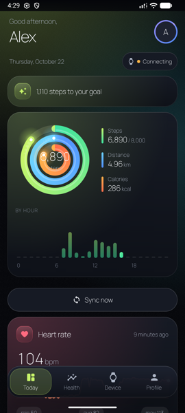
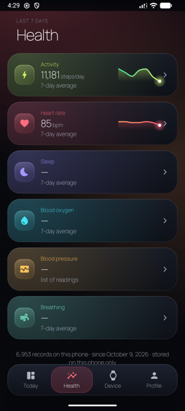
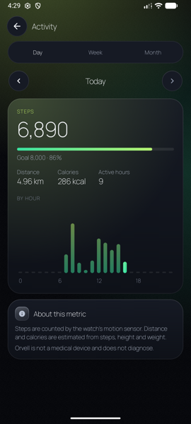
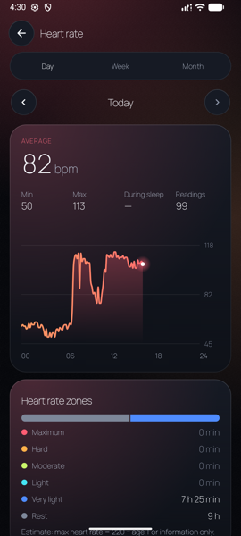
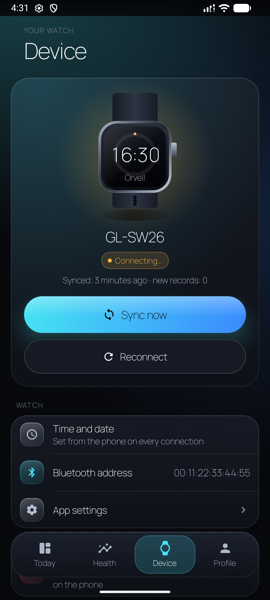
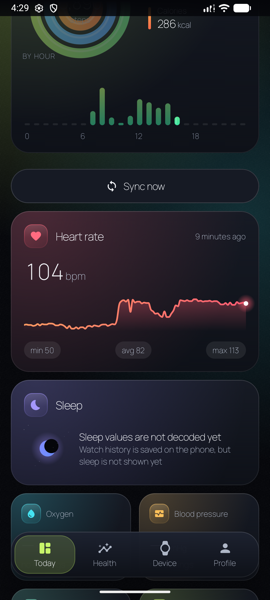
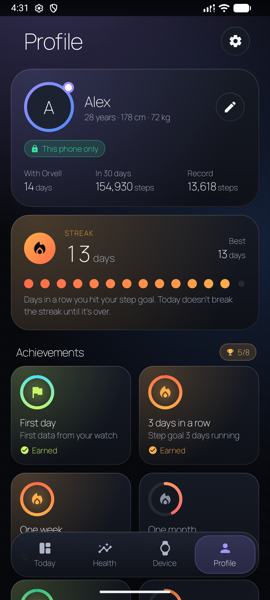
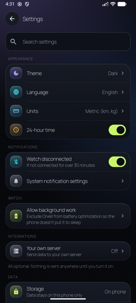
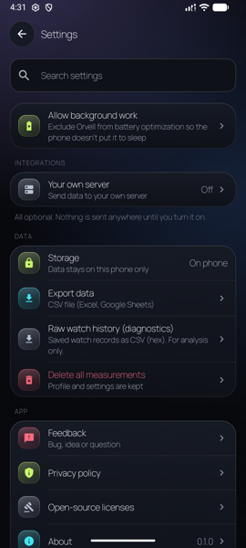

# Orvell

**A local-first Android app for FitCloud (TopStep) smartwatches** — the cheap watches that normally need the FitCloudPro app
(for example the GreenLion GL-SW26). Orvell talks to the watch directly over Bluetooth LE, stores everything **on your phone**,
and shows it in a clean, dark-first interface. No account, no cloud, no analytics.

> **Status: early development (v0.1.0), not on Google Play.** Pairing, time sync, history sync and **steps** work end to end.
> Distance, calories and heart rate are decoded but not yet cross-checked against the watch screen. Sleep, SpO₂, blood pressure
> and battery are **not** decoded yet — see [What works and what doesn't](#what-works-and-what-doesnt).
> Tested on **one watch (GL-SW26) and one phone**. Read the [known issues](#known-issues) before you try it.

<p align="center">
  
  
  
  
  
</p>
<p align="center">
  
  
  
  
</p>

*Screenshots are from an Android emulator with **synthetic sample data** (the profile "Alex" is made up) and no watch attached,
which is why the watch status reads "Connecting…". Nothing in them is anyone's real health data.*

## Why Orvell

- **Your data stays on your phone.** SQLite on the device is the single source of truth; the UI only reads from it, so the app works
  fully offline. The `INTERNET` permission exists only for the optional "your own server" sync, which is off by default
  ("Nothing is sent anywhere until you turn it on").
- **No trackers.** The dependency list is AndroidX, Jetpack Compose and Kotlin coroutines — no analytics, ads, crash-reporting or
  Google Play Services SDKs (see [`app/build.gradle.kts`](app/build.gradle.kts)).
- **The watch protocol is independent and documented.** The codec in [`watch-protocol/`](watch-protocol) was written from our own
  Bluetooth captures, and every byte layout is written down in [`docs/clean-room/spec/`](docs/clean-room/spec) with a confidence tag
  (**[T]** verified, **[E]** estimate, **[N]** not verified). 100 JVM tests check it against byte vectors from real logs.
- **It admits what it doesn't know.** If a value isn't decoded, the app shows "—" and says "values are not decoded yet" instead of
  inventing a number or showing a fake zero.
- **Your own server, your own AI (optional).** Orvell can push measurements to a server you run (`POST /ingest`) and react to a
  "refresh now" request over SSE, so you can plug your data into your own stack. The server is not part of this repository.
- **Made for Uzbek speakers first**, with Uzbek, English and Russian UI, light / dark / system themes and metric / imperial units.
- **Its own design system** — "orbit" progress rings, meaningful colours (activity green, heart red, sleep violet, oxygen blue,
  pressure yellow), Manrope font, haptics and reduced-motion support.

## What works and what doesn't

"Verified" below means the author checked it on a real watch and phone during development (October 2026). The public copy of the
code was not re-tested on hardware; what was re-run for it is the build, the lint check and all unit tests (see [Build](#build)).

### Works
| Area | Details |
|---|---|
| Pairing | Scan, bind and unbind the watch; one persistent connection with auto-reconnect (foreground service). Verified |
| Time sync | Phone time is sent to the watch on every connection. Verified on the watch screen |
| History sync | Chunked history records are received, **saved to the database first, then acknowledged** (so nothing is lost if the link drops). Runs on connect and every 15 minutes, or on demand ("Sync now"). Verified |
| Steps | Decoded from 5-minute history buckets; the day total matched the watch's own counter in the author's test. Day / week / month views, goals, streaks and achievements |
| Phone step sensor | Used as a fallback only when the watch has no step records for the day; the source is shown on screen |
| Profile and goals | Name, sex, birth date, height, weight, daily goals (steps, sleep, kcal, distance) |
| Export / delete | CSV export of phone data and of raw watch history; delete all data |
| Optional server sync | `POST /ingest`, `GET /status`, SSE `/device/stream`, `POST /device/ack`; the token is redacted from error messages; release builds accept HTTPS only |
| UI extras | Onboarding, 3 languages, themes, units, privacy screen, licences screen, feedback by e-mail intent |
| Tests | 100 protocol tests + 109 app tests (JVM), all passing; lint: 0 errors / 28 warnings |

### Partial or not verified
- **Distance, calories and heart rate** are decoded from history records (spec + byte-vector tests) and shown in the app, but were not
  cross-checked value by value against the watch screen.
- **Reconnect after walking away** (10 m or more) has not been tested at distance — only Bluetooth off/on and app restart.
- **Watch face upload**: the transfer protocol is implemented and tested (`watch-protocol`, `WatchManager.uploadFace`). A face file taken
  from FitCloudPro installed and showed on the watch, but faces generated by Orvell itself did not install, so the UI was removed.
  Only a debug-build receiver remains.
- **Release (R8) build** has not been run on a phone; only the debug build has been.

### Not working / not implemented
- **Sleep, blood oxygen (SpO₂), blood pressure, breathing rate:** records are stored raw but **not decoded**; the screens show "—".
- **Battery level:** the field has not been identified in the protocol yet.
- **Live "Measure now":** removed from the UI until it is verified again.
- Alarms, find-my-watch, notifications to the watch, weather, contacts and do-not-disturb are **not implemented**.
- No cloud accounts, no Health Connect, no iOS.

## Known issues

These are things that surprised the author during testing — not a complete bug list.

1. **One app at a time.** The watch binds to a single app. Orvell and FitCloudPro cannot be used together; using FitCloudPro can break
   the pairing.
2. **Step counter resets.** The watch restarts its step counter on every new connection, and steps from before a gap were missing
   from the history we received. Orvell never lowers a day's total, but daily numbers can be lower than the watch screen after
   reconnects. The cause is not confirmed.
3. **Don't tap the watch in Android's Bluetooth settings.** The phone then tries to connect audio (A2DP) and shows "Couldn't connect".
   The watch does not support audio or call profiles; disabling "Media audio" for it in system settings avoids the message.
4. **Re-pairing prompts.** After Bluetooth is turned off and on, the watch may ask once for a ✓ confirmation.
5. **Imperial units:** the height / weight dialog still edits in cm / kg.
6. **Accessibility is incomplete** (33 content descriptions so far; no full TalkBack pass).
7. **Only one watch model and one phone have been tested.** Other FitCloud / TopStep watches may behave differently.
8. **The BLE client itself has no automated tests** — the framing, bind flow and history flow are tested, the Android Bluetooth glue is not.

## Build

Requirements: JDK 17+ and the Android SDK (compileSdk 37; minSdk 28, targetSdk 36).

```bash
echo "sdk.dir=/path/to/Android/sdk" > local.properties        # not committed
./gradlew :watch-protocol:test :app:testDebugUnitTest :app:assembleDebug
```

The debug build installs as `uz.xasan.orvell.dev`. Release signing reads an untracked `keystore.properties`
(template: [`keystore.properties.example`](keystore.properties.example)); without it the release is built unsigned.

## Repository layout

| Path | What |
|---|---|
| `app/` | Android app — Jetpack Compose UI (`ui/`), BLE client and connection manager (`watch/`), SQLite store and settings (`data/`), optional server sync (`sync/`) |
| `watch-protocol/` | Pure Kotlin/JVM FitCloud codec: frames, CRC-16/ARC, TLV messages, bind, time, history records, watch-face upload |
| `docs/clean-room/spec/` | The protocol notes with confidence tags, plus open questions |
| `tools/snoop/` | Parser for Android Bluetooth HCI (`btsnoop`) logs used to derive the spec |
| `docs/DESIGN-BRIEF.md`, `docs/UI-REDESIGN.md` | Design notes (the brief is partly outdated; see the banner at its top) |
| `docs/privacy/` | The privacy policy page (uz / en / ru) |

How the protocol notes were produced: [`docs/clean-room/README.md`](docs/clean-room/README.md). Short version: our own captures
and public Bluetooth specs only; earlier versions of the project were based on the Gadgetbridge project (AGPL-3.0) and that code was
replaced. This is a good-faith engineering process, **not legal advice or a guarantee** that nothing infringes.

## Disclaimer

Orvell is **not affiliated with** FitCloud, FitCloudPro, TopStep, GreenLion, Gadgetbridge or any watch maker; those names belong to
their owners and are used only to say which watches Orvell works with. Orvell is **not a medical device** and does not diagnose
anything — wrist-watch heart-rate numbers are for information only.

## License

[MIT](LICENSE) — you may use, copy, modify and distribute the code, including commercially, as long as the copyright and license
notice are kept. The code is provided as-is, without warranty. The bundled Manrope font (SIL OFL-1.1) and Apache-2.0 libraries keep
their own licenses (shown in the app under Settings → About → Open-source licenses). This public repository starts from the
current, independently written codebase.

## Contact

- Telegram: [@Astra_AI_Agent](https://t.me/Astra_AI_Agent)
- GitHub: [@Steadfast11](https://github.com/Steadfast11) — issues are welcome

---

## O'zbekcha qisqacha

**Orvell** — FitCloud (TopStep) platformasidagi arzon smart-soatlar (masalan GreenLion GL-SW26) uchun Android ilova. Soat bilan
to'g'ridan-to'g'ri Bluetooth orqali ishlaydi, **ma'lumot faqat telefoningizda** saqlanadi. Akkaunt, bulut va kuzatuvchi kutubxonalar yo'q.

> **Holat:** erta bosqich (v0.1.0), Google Play'da yo'q. Ulash, vaqt va tarix sinxroni hamda **qadam** to'liq ishlaydi. Masofa, kaloriya
> va yurak urishi dekodlanadi, lekin soat ekrani bilan hali solishtirilmagan. Uyqu, SpO₂, qon bosimi va batareya foizi **hali ochilmagan**
> (ilovada "—" ko'rinadi). Faqat bitta soat (GL-SW26) va bitta telefonda sinalgan.

**Nima bilan farq qiladi**
- Ma'lumot telefondan chiqmaydi; internet faqat ixtiyoriy "o'z serveringiz" sinxroni uchun (sukut bo'yicha o'chiq).
- Soat protokoli o'z Bluetooth loglarimizdan mustaqil yozilgan va [`docs/clean-room/spec/`](docs/clean-room/spec) da ishonch
  darajasi bilan hujjatlashtirilgan; 100 ta protokol testi bor.
- Bilmagan narsasini to'qimaydi: dekodlanmagan qiymat o'rniga "—" va "hali dekodlanmagan" deb yozadi.
- O'zbek, ingliz va rus tillari; qorong'i/yorug' mavzu; o'ziga xos "orbit" dizayn tizimi.

**Ishlaydi:** ulash/ajratish, doimiy ulanish va avto-qayta ulanish, vaqt sinxroni, tarix sinxroni (avval bazaga yoziladi, keyin soatga
tasdiq yuboriladi), qadam, maqsadlar, streak va yutuqlar, CSV eksport, ixtiyoriy server sinxroni.

**Qisman / tekshirilmagan:** masofa, kaloriya, yurak urishi (dekodlanadi, soat ekrani bilan solishtirilmagan); uzoqdan qaytganda
avto-ulanish; siferblat yuklash (UI olib tashlangan).

**Ishlamaydi / hali yo'q:** uyqu, SpO₂, qon bosimi, nafas, batareya foizi, jonli o'lchash, budilnik, soatni topish, bildirishnomalar,
ob-havo, bulut akkaunt, Health Connect, iOS.

**Ma'lum muammolar:** soat bir vaqtda faqat bitta ilovaga bog'lanadi (FitCloudPro bilan birga ishlamaydi); soat qadam hisoblagichi
qayta ulanganda nollanishi mumkin; Android Bluetooth menyusida soatni bosmang (audio ulanishga urinadi).

**Aloqa:** Telegram — [@Astra_AI_Agent](https://t.me/Astra_AI_Agent) · GitHub — [@Steadfast11](https://github.com/Steadfast11)

**Litsenziya:** [MIT](LICENSE) — kodni ishlatish, nusxalash, o'zgartirish va tarqatish mumkin. Orvell tibbiy qurilma emas.
